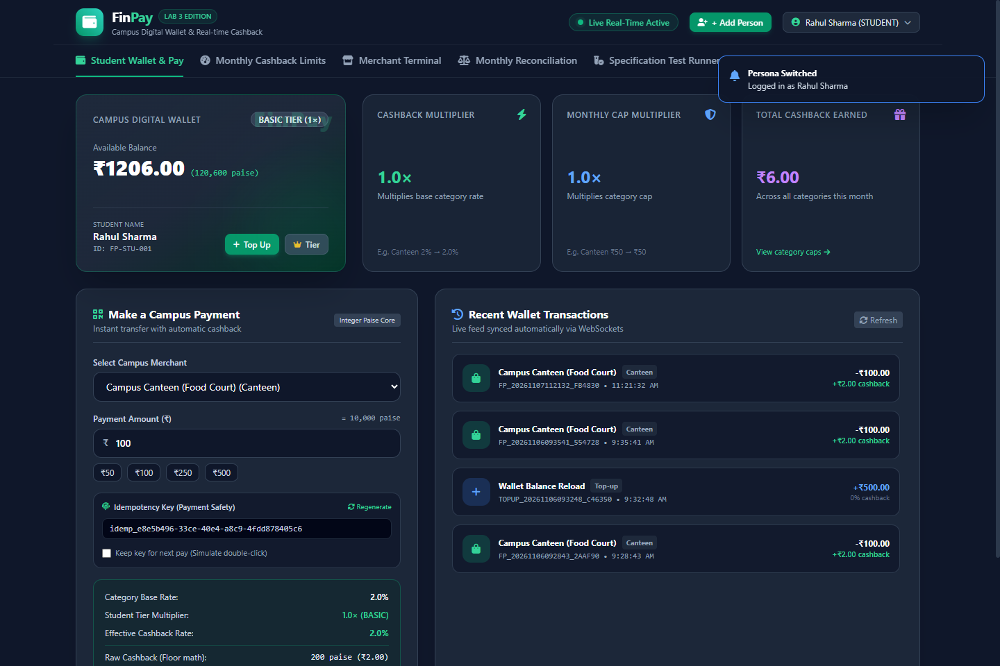
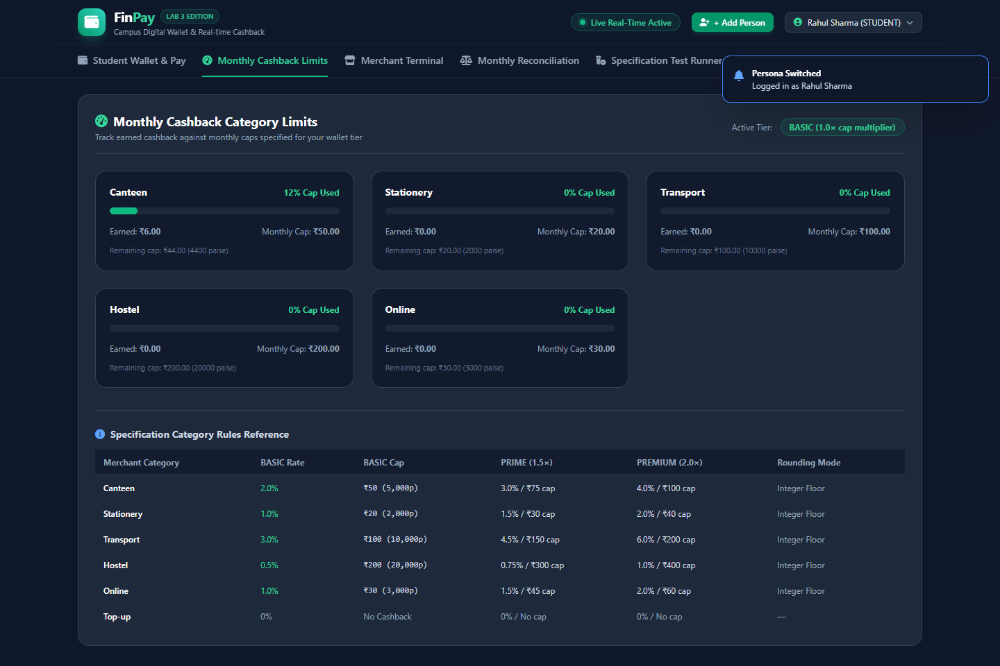
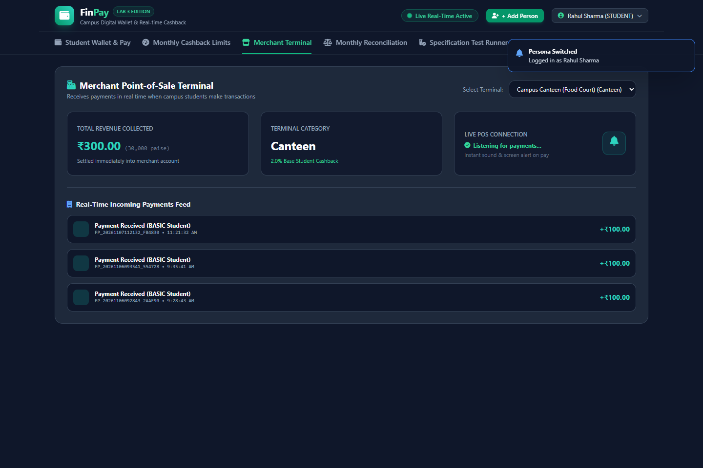
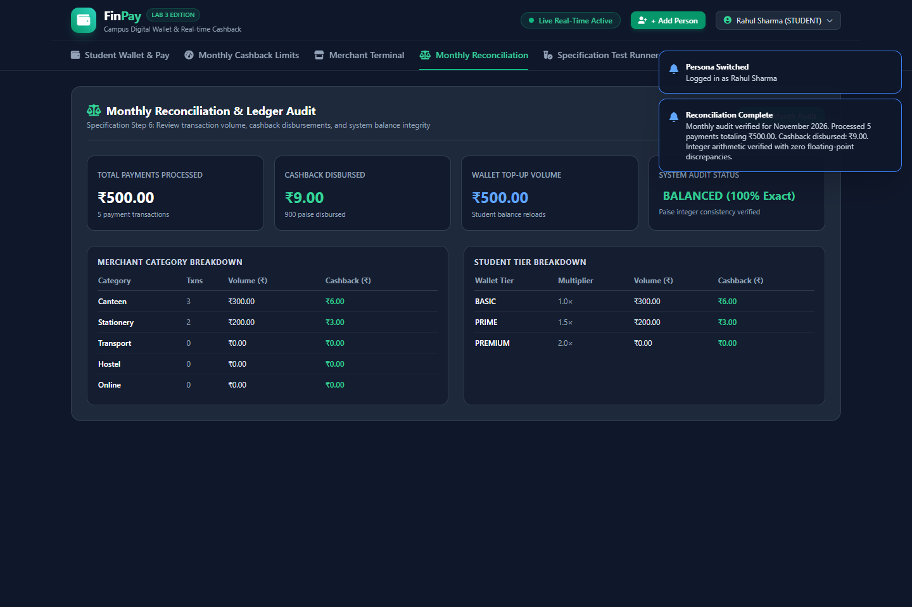
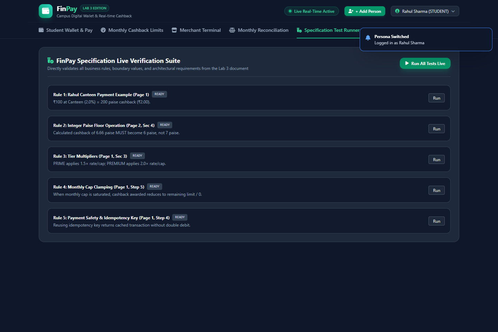
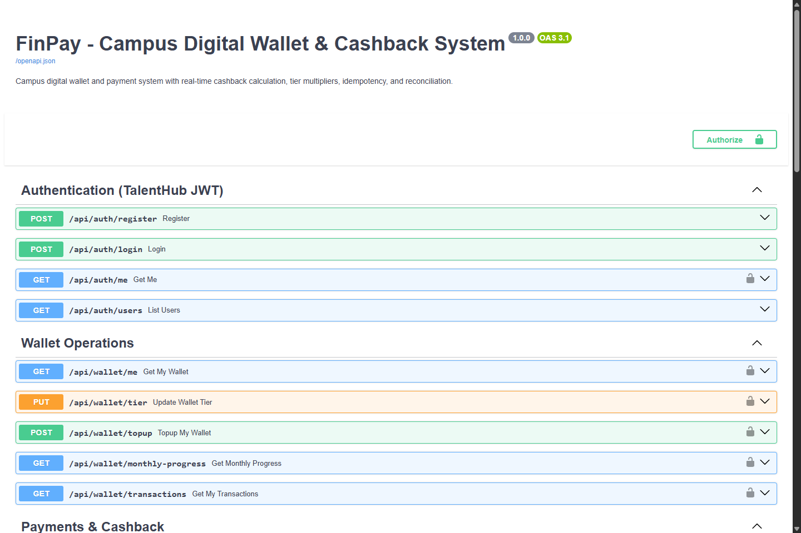

# 💳 FinPay — Campus Digital Wallet & Real-Time Cashback System

[](https://www.python.org/)
[](https://fastapi.tiangolo.com/)
[](https://www.sqlite.org/)
[](https://websockets.readthedocs.io/)
[](https://tailwindcss.com/)
[](https://docs.pytest.org/)
[](LICENSE)

**FinPay** is a campus digital payment and wallet web application. Students make real-time payments across campus merchants (Canteen, Stationery, Transit, Hostel, and Online), earn automated cashback calculated strictly using **integer-paise deterministic floor arithmetic**, enjoy wallet tier multipliers (`BASIC`, `PRIME`, `PREMIUM`), and benefit from **payment idempotency** and **monthly cashback limits**.

---

## 🏛️ System Architecture

FinPay strictly adheres to the **4-layer decoupled software engineering architecture**:

```
┌────────────────────────────────────────────────────────┐
│                   ROUTER LAYER                         │
│  FastAPI Endpoints: /auth, /wallet, /payments, /ws     │
└──────────────────────────┬─────────────────────────────┘
                           │
┌──────────────────────────▼─────────────────────────────┐
│                   SERVICE LAYER                        │
│  • calculate_cashback()  • process_payment()           │
│  • wallet_service        • reconciliation_service      │
└──────────────────────────┬─────────────────────────────┘
                           │
┌──────────────────────────▼─────────────────────────────┐
│                 REPOSITORY LAYER                       │
│  • WalletRepo            • TransactionRepo             │
│  • MerchantRepo          • IdempotencyRepo             │
└──────────────────────────┬─────────────────────────────┘
                           │
┌──────────────────────────▼─────────────────────────────┐
│             MODEL & DATABASE LAYER                     │
│  SQLAlchemy ORM + SQLite (Strict Integer Paise Engine) │
└────────────────────────────────────────────────────────┘
```

### Architectural Layer Responsibilities
* **Router Layer** (`app/routers/`): Handles HTTP routing, Swagger docs, JWT authorization, and WebSocket connections.
* **Service Layer** (`app/services/`): Implements pure domain calculations (`calculate_cashback`), payment orchestration (`process_payment`), monthly limit clamping, and ledger reconciliation.
* **Repository Layer** (`app/repositories/`): Isolates database transactions and queries away from business logic.
* **Model Layer** (`app/models/`): Defines normalized relational models using strictly integer-paise for monetary columns.

---

## ⚙️ Core Financial Rules & Mathematical Specifications

### 1. Strict Integer-Paise Arithmetic
To eliminate IEEE 754 floating-point rounding bugs, **all financial calculations, balances, and database columns strictly use integer paise** (1 INR = 100 paise). Floating-point currency storage is strictly prohibited.

### 2. The Deterministic Floor Operation Rule
Cashback is calculated in paise using the floor operation rather than rounding:

```python
# Pure service calculation (Zero floating-point rounding errors)
raw_cashback_paise = math.floor((amount_paise * (base_rate_bps * tier_multiplier)) / 10000)
```

* **Lab Example:** A payment of ₹3.33 (333 paise) at the Canteen (2.0% base rate) yields 6.66 paise, which is strictly floored to **6 paise** (never rounded up to 7 paise).

### 3. Wallet Tiers & Multipliers
| Tier | Rate Multiplier | Cap Multiplier | Canteen Rate | Canteen Monthly Cap |
| :--- | :--- | :--- | :--- | :--- |
| **`BASIC`** | **1.0×** | **1.0×** | 2.0% | ₹50.00 (5,000 paise) |
| **`PRIME`** | **1.5×** | **1.5×** | 3.0% | ₹75.00 (7,500 paise) |
| **`PREMIUM`** | **2.0×** | **2.0×** | 4.0% | ₹100.00 (10,000 paise) |

### 4. Merchant Category Rules & BASIC Monthly Caps
| Category | BASIC Base Rate | BASIC Monthly Cap | Rounding Mode |
| :--- | :--- | :--- | :--- |
| 🍔 **Canteen** | 2.0% (200 bps) | ₹50 (5,000 paise) | Integer Floor |
| 📚 **Stationery** | 1.0% (100 bps) | ₹20 (2,000 paise) | Integer Floor |
| 🚌 **Transport** | 3.0% (300 bps) | ₹100 (10,000 paise) | Integer Floor |
| 🛏️ **Hostel** | 0.5% (50 bps) | ₹200 (20,000 paise) | Integer Floor |
| 💻 **Online** | 1.0% (100 bps) | ₹30 (3,000 paise) | Integer Floor |
| 💳 **Top-up** | 0.0% (0 bps) | No cashback | — |

### 5. Monthly Cap Enforcement
The system tracks the accumulated cashback earned by a student in each category during the current calendar month:

```python
# Monthly Cap Saturation Logic:
remaining_cap_paise = max(0, tier_monthly_cap_paise - accumulated_monthly_cashback_paise)
cashback_awarded_paise = min(raw_cashback_paise, remaining_cap_paise)
```

When a student reaches their monthly cap in a category, subsequent payments award **₹0.00 cashback** until the 1st of the next month.

### 6. Payment Idempotency Protection
Every payment request includes a unique client-generated `idempotency_key` (UUID). If a network timeout or accidental double-click replays the same key:
- The system returns the cached transaction response.
- **Zero double-debit** occurs.
- The response sets `"is_idempotent_replay": true`.

---

## 👥 Pre-Seeded Accounts

| Name | Role | Tier | Email | Password | Initial Balance |
| :--- | :--- | :--- | :--- | :--- | :--- |
| **Rahul Sharma** | Student | `BASIC` | `rahul@campus.edu` | `password123` | ₹1,000.00 |
| **Priya Patel** | Student | `PRIME` | `priya@campus.edu` | `password123` | ₹2,500.00 |
| **Amit Verma** | Student | `PREMIUM`| `amit@campus.edu` | `password123` | ₹5,000.00 |
| **Auditor Admin** | Auditor | `ADMIN` | `admin@campus.edu` | `adminpassword` | — |

*Note: You can also create brand-new students with custom balances at any time using the **`+ Add Person`** button in the UI header!*

---

## 🚀 Quick Start Guide

### 1. Prerequisites
- Python 3.10+
- pip

### 2. Clone & Install
```bash
git clone https://github.com/sunayanakamat04/finpay-payment-system.git
cd finpay-payment-system
pip install -r requirements.txt
```

### 3. Launch the Application
On Windows:
```cmd
start.bat
```
Or with PowerShell:
```powershell
.\run.ps1
```
Or directly via Python:
```bash
python -m uvicorn finpay.backend.app.main:app --host 127.0.0.1 --port 8000 --reload
```

Open your browser to:
* **Web Application**: [http://127.0.0.1:8000/](http://127.0.0.1:8000/)
* **Swagger API Documentation**: [http://127.0.0.1:8000/docs](http://127.0.0.1:8000/docs)
* **ReDoc Technical Specs**: [http://127.0.0.1:8000/redoc](http://127.0.0.1:8000/redoc)

---

## 🧪 Running the Test Suite

Run the automated test suite verifying all 10 specification edge cases:
```bash
python -m pytest finpay/backend/tests -v
```

```
============================= test session starts =============================
finpay/backend/tests/test_cashback.py::test_rahul_scenario_example PASSED [ 10%]
finpay/backend/tests/test_floor_operation_rule PASSED  [ 20%]
finpay/backend/tests/test_wallet_tiers_multipliers PASSED [ 30%]
finpay/backend/tests/test_all_merchant_categories_basic PASSED [ 40%]
finpay/backend/tests/test_monthly_cap_multiplier PASSED [ 50%]
finpay/backend/tests/test_zero_and_negative_amounts PASSED [ 60%]
finpay/backend/tests/test_payment.py::test_rahul_payment_and_cashback PASSED [ 70%]
finpay/backend/tests/test_payment.py::test_idempotency_safety PASSED     [ 80%]
finpay/backend/tests/test_payment.py::test_monthly_cap_clamping PASSED   [ 90%]
finpay/backend/tests/test_reconciliation.py::test_monthly_reconciliation_accuracy PASSED [100%]
============================== 10 passed in 3.12s ==============================
```

---

## 📸 Screenshots Showcase

### 1. Student Wallet Dashboard & Live Payment Portal


### 2. Real-Time Monthly Category Cashback Limits


### 3. Merchant Point-of-Sale Terminal


### 4. Monthly Reconciliation & Balance Integrity Ledger


### 5. Interactive Specification Test Runner


### 6. Interactive Swagger API Documentation


---

## 📄 License

Distributed under the **MIT License**. See [`LICENSE`](LICENSE) for full details and permissions.

```text
Copyright (c) 2026 Sunayana Kamat
FinPay — Campus Digital Wallet & Real-Time Cashback System
```
